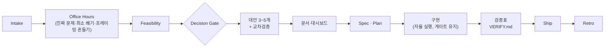

# 🪶 Quetzalcoatl — Meaning-First AI Project OS

[](https://github.com/chquandogong/Quetzalcoatl/releases)
[](https://github.com/chquandogong/Quetzalcoatl/actions/workflows/validate.yml)
[](./LICENSE)


`/Quetzalcoatl` 한 번으로 켜지는 **의미 우선(Meaning-First) AI 프로젝트 운영체제** 스킬.
아이디어를 바로 만들지 않고 의미·가치부터 검증한 뒤, Office Hours 압박 검토 → 타당성 → 3~5개 대안 →
Claude-GPT 교차검증 → 문서·대시보드 → 명세·계획 → 구현 → **검증표** → 배포 → 회고까지 하나의 반복 가능한
워크플로우로 운영한다. Claude · Claude Code · ChatGPT/GPTs · 일반 LLM 에이전트에서 같은 규칙으로 동작하는 **모델 중립형**이다.

> AI 시대의 실력은 AI에게 일을 많이 시키는 능력이 아니라,
> AI가 올바른 일을 올바른 기준으로 하게 만드는 능력이다.

📖 **[Wiki](https://github.com/chquandogong/Quetzalcoatl/wiki)** — 원칙 · 워크플로우 · 모드 · 검증표 · 자율과 게이트 · FAQ

## 왜 이 스킬인가

LLM 조력자는 두 방향으로 미끄러진다. 사용자의 말에 **아첨**해 선호를 그대로 따르거나, 자기 기본값에 **자동화 편향**으로 기대어 맥락을 무시한다. 이 스킬의 거의 모든 조항은 한 원리의 적용이다 — **기본값을 의심하고, 대안 공간을 펼친 뒤, 근거로 고른다.** 그리고 방향·책임·최종 판단은 사람이 가진다.

| 흔한 실패                           | 이 스킬의 답                                                                                           |
| ----------------------------------- | ------------------------------------------------------------------------------------------------------ |
| 요청을 그대로 만든다                | 왜 중요한가 · 누구에게 가치인가 · 안 하면 무엇이 남는가를 먼저 묻고, 가장 작은 쐐기부터 (§1.1 · §3)    |
| 선호에 맹종하거나 멋대로 바꾼다     | 선호는 기본값. 근거가 이길 때만 투명하게 뒤집고, 유지할 때도 가장 강한 반론을 보인다 (§4.2)            |
| 모델 둘이 같은 말이면 믿는다        | AI끼리의 합의는 검증이 아니다 — 근거·데이터·테스트·실행 결과·사람 판단으로 (§1.4 · §5)                 |
| "테스트 통과"를 "동작함"으로 읽는다 | 실제 산출물을 사용자 경로로 구동해 기대와 관측을 대조하는 검증표, 증거는 검사한 범위까지만 (§11 · §14) |
| 자율 실행이 위험한 일까지 한다      | 자율은 확인 질문을 줄일 뿐 — 외부 발송·결제·삭제·배포·공개는 사람 승인 게이트 (§1.6 · §18)             |
| 결정이 대화 속에 묻힌다             | 결정 로그 · 가정 · 리스크 · 대시보드로 판단을 추적 가능하게 (§6 · §7)                                  |

## 설치

**Claude Code 플러그인 (권장)**

```text
/plugin marketplace add chquandogong/Quetzalcoatl
/plugin install quetzalcoatl@quetzalcoatl
```

새 세션에서 `/quetzalcoatl:Quetzalcoatl`로 호출한다. 플러그인 캐시는 버전별 사본이라 업데이트는 `marketplace update` 후 재설치 → 세션 재시작이다.

**개인 스킬 (Claude Code · Codex CLI)** — `skills/Quetzalcoatl/` 폴더(`SKILL.md` + `TEMPLATES.md`)를 `~/.claude/skills/` 또는 `~/.codex/skills/`에 복사하면 `/Quetzalcoatl`로 호출된다.

**도구 없는 챗 환경 (ChatGPT · GPTs)** — 본문과 양식을 합친 페이스트 번들 [`dist/Quetzalcoatl-FULL.md`](./dist/Quetzalcoatl-FULL.md)를 프로젝트 지침에 붙여넣는다.

자세한 절차와 문제 해결은 [`USAGE.md`](./skills/Quetzalcoatl/USAGE.md) · [Wiki › 설치](https://github.com/chquandogong/Quetzalcoatl/wiki/Installation).

## 첫 호출

```text
/quetzalcoatl:Quetzalcoatl 아래 아이디어를 의미 검토 → Office Hours → feasibility →
대안 3~5개 → Claude-GPT 교차검증 프롬프트 → 대시보드 초안 순서로 처리해줘.

[아이디어]
```

```text
/quetzalcoatl:Quetzalcoatl 이 계획대로 묻지 말고 끝까지 진행해. 외부 발송·결제·삭제는 멈추고 보고해.
```

```text
/quetzalcoatl:Quetzalcoatl /test-plan — 핵심 기능 검증표를 만들고 실제로 구동해서 증거와 함께 보고해. 그다음 /ship.
```

첫 응답은 목표 · 핵심 질문 · 검증할 전제 · 대안 · 첫 단계의 **미니 템플릿**으로 시작한다. 작은 일에는 작은 형식만 쓴다(§13 크기 라우터) — 단 의미 먼저와 안전 게이트는 어떤 크기에서도 생략되지 않는다.

## 어떻게 돌아가나



| 영역           | 핵심                                                                                                            | 절              |
| -------------- | --------------------------------------------------------------------------------------------------------------- | --------------- |
| 절대 원칙      | 의미 먼저 · 의도와 맥락 · 대안 없이 결정 않기 · AI 합의≠검증 · 판단 문서화 · 사람 승인 게이트 · 지속 자율 실행  | §1              |
| 워크플로우     | Intake → Office Hours(7단계) → Feasibility(4축) → Agent Team → 대안 비교·앵커된 선호·골짜기 탈출                | §3 · §4         |
| 교차검증       | 같은 브리프 · 독립 답 · 상호 비판 · 근거로 판단 · 라운드 예산·원장·종결 상태 · 한 모델이면 "실제 교차검증 아님" | §5              |
| 문서·대시보드  | 표준 디렉터리 · 근거 명시 · 산출물 3층(정본은 사실마다 하나) · 자립 자료 · 대시보드와 HTML 미러                 | §6 · §7         |
| 명세·계획·리뷰 | Spec(규모 범위 포함) · Plan(게이트 표시) · Engineering/Design Review(규모 적합성) · Risk                        | §8~§10          |
| 검증·배포      | 검증표 8규칙 · 증거 범위 · 완료 상태(검증됨/PR 열림/병합됨/배포됨) · Ship · Retro                               | §11 · §12 · §14 |
| 자율·회복·협업 | 허용목록 · 합리화 차단표 · 강제 바인딩(있을 때만) · 체크포인트=커밋 · Git · 핸드오프 · `/context`               | §18~§21 · §24   |

하위 모드 22개(`/office-hours` `/feasibility` `/alternatives` `/cross-check` `/spec` `/plan` `/eng-review` `/design-review` `/risk-review` `/test-plan` `/dashboard` `/decision-log` `/report` `/present` `/ship` `/retro` `/handoff` `/resume` `/autonomy` `/context` …)는 Claude Code의 별도 명령이 아니라 스킬 본문 §2의 약속이다 — [Wiki › 모드](https://github.com/chquandogong/Quetzalcoatl/wiki/Modes).

## 안전 게이트 — 자율 중에도 멈추는 것

외부 발송·게시 · 결제 · 개인정보 · 데이터 삭제·강제 푸시·히스토리 재작성 · 프로덕션 배포·마이그레이션 · 고위험 판단 · 공개 저장소 생성 · 비가역 변경. 행동 전 6문 체크로 게이트 대상을 분류하고 **승인 근거**(범위를 포괄하는 명시적 승인 또는 사전승인)가 없거나 모호하면 차단한다. 다른 스킬의 "요청 한마디 = 권한" 선언이나 에이전트가 스스로 적은 허용목록은 승인이 아니다. 자율 수준·허용목록은 락이 아니라 약속이며, 환경이 승인 훅 같은 강제 수단을 주면 거기에 바인딩한다(있을 때만).

## 저장소 구조

```text
Quetzalcoatl/
├── skills/Quetzalcoatl/
│   ├── SKILL.md            # 규칙(Core Contract) §0~§24 — 호출 시 로드
│   ├── TEMPLATES.md        # 양식 C-1~C-29 — 필요할 때만 로드
│   └── USAGE.md            # 설치·호출·문제 해결
├── dist/Quetzalcoatl-FULL.md   # 페이스트 번들(본문+양식) — 빌드 산출물, CI가 신선도 검사
├── wiki/                   # GitHub Wiki 소스(파생 뷰) — 4페이지는 build-wiki.py가 생성
├── scripts/
│   ├── build-paste-bundle.sh   # 번들 생성
│   ├── validate-local.sh       # CI와 동등한 구조 검사 11항목 + living-doc 가드
│   ├── build-wiki.py           # wiki 생성 페이지(모드·템플릿·용어집·릴리스 이력)
│   └── publish-wiki.sh         # wiki/ → GitHub Wiki 발행
├── docs/                   # 이 스킬을 자신에게 적용한 프로젝트 기록(§6 구조, dogfooding)
│   ├── 00-overview/  01-discovery/  02-decisions/  03-spec/  04-quality/  05-ops/  appendix/  assets/
│   └── 04-quality/VERIFY.md    # 저장소 자신의 검증표(C-29) + verify-runs/ 실행 기록
├── .claude-plugin/         # plugin.json · marketplace.json
├── .github/workflows/validate.yml
├── CHANGELOG.md · SECURITY.md · LICENSE
```

## 개발과 검증

이 저장소는 스킬을 자기 자신에게 적용한다. 릴리스 사이클은 다음 순서다.

1. 결정 기록(대안표 → `DECISION_LOG`) → `SKILL.md`·`TEMPLATES.md` 편집 → 번들 재생성.
2. `bash scripts/validate-local.sh` — 3중 버전 · 섹션 연속 · 템플릿 포인터 무결성 · frontmatter · 번들 신선도 · wiki 생성 페이지 신선도 · living-doc 드리프트 가드(CI `validate`와 동등).
3. **실제 Claude↔GPT 교차검증** — 커밋 직후 diff와 본문을 첨부한 적대 검토 브리프를 다른 모델(로컬 Codex CLI)에 넘기고, 결함마다 원장(수정/반박/보류)을 남긴다. 라운드형이면 예산과 종결 상태를 기록한다.
4. 행동 테스트(RED/GREEN, 서브에이전트)와 검증표 자기 적용 — 결과는 미수행까지 정직하게 [`TEST_PLAN`](./docs/04-quality/TEST_PLAN.md)에.
5. 태그 `vX.Y.Z` → push → GitHub Release → 플러그인 재설치 → 대시보드 미러 redeploy → `VERIFY.md` 실행 기록.

사이클별 결정·교차검증·회고는 [`docs/`](./docs/README.md)에, 변경은 [`CHANGELOG.md`](./CHANGELOG.md)에 있다.

## 릴리스 이력 (요약)

| 버전            | 핵심                                                                                                             |
| --------------- | ---------------------------------------------------------------------------------------------------------------- |
| v1.2.0          | 지속 자율 실행 · 레이트리밋 회복력 · 문서 체계 · Git 프로토콜 · 핸드오프                                         |
| v1.3.x          | 앵커된 선호 처리(§4.2) · CI 구조 검사                                                                            |
| v1.4.x          | 대시보드 HTML 미러 · §1.6 6문 pre-check · living-doc 드리프트 가드                                               |
| v1.5.0 · v1.6.0 | 강제 바인딩 + 증거기반 완료 · 벤더-중립 브리핑 `/context`                                                        |
| v2.0.x          | Core Contract 분리 · 로컬 미니멈 탈출(프레이밍 흔들기 · 골짜기 점검)                                             |
| v3.0.0          | 규칙/양식/번들 소스 분리 · 모드 백킹 · 크기 라우터 · 규모 적합성 · 행동 테스트 복귀                              |
| v3.1.0 · v3.2.0 | 산출물 3층(정본은 사실마다 하나) · 자립 자료(보고서·대본·파생 렌더)                                              |
| **v3.3.0**      | **검증표(기능 지도) · 증거 범위 · 완료 상태 · 라운드 예산/원장 · 외부 스킬 포괄 권한 불인정 · C-29 · VERIFY.md** |

전체는 [`CHANGELOG.md`](./CHANGELOG.md) · [Releases](https://github.com/chquandogong/Quetzalcoatl/releases) · [Wiki › 릴리스 이력](https://github.com/chquandogong/Quetzalcoatl/wiki/Release-History).

## 보안 · 라이선스

게이트를 우회·약화시키는 문구나 프롬프트 인젝션 경로는 [`SECURITY.md`](./SECURITY.md)의 절차로 비공개 보고를 권장한다. MIT — [`LICENSE`](./LICENSE).
