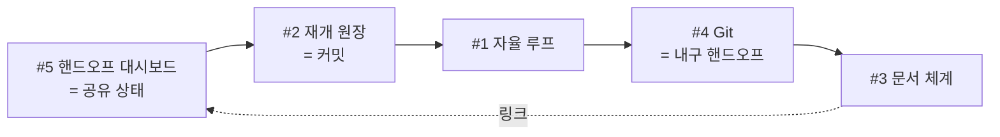

# Quetzalcoatl 프로젝트 문서

> 상태: 활성 · 날짜: 2026-10-27 · 소유자: Quetzalcoatl OS · 승인: CHENGHAO QUAN

이 디렉터리는 **Quetzalcoatl 스킬 자신의 개발**을 Quetzalcoatl 문서 체계(SKILL.md §6)로 관리한 것이다(dogfooding).
현재 사이클: **v3.3.0 — 검증표(기능 지도) 프로토콜**: 외부 스킬 스택 둘(Pstack·Tstack)의 분석을 1차 자료로 검증한 뒤, 그들이 잘한 세 칸 — 증거를 어떻게 만드는가(검증표 `VERIFY.md` · C-29) · 무엇만으로는 증거가 아닌가(목 테스트·CI·봇 승인·자기 보고 — 증거 범위) · 완료가 어느 상태인가(검증됨/PR 열림/병합됨/배포됨) — 를 **§11 확장 + §14 · §12.1 · §5.2 8~10 + C-29**로 반영하고, 외부 스킬의 포괄 테스트 권한·에이전트의 허용목록 등재는 승인이 아님을 명문화(§1.6·§18.2·§15, D18). 실제 GPT 교차검증 3라운드(REJECT 94 → 반영 → …) + **행동 테스트 복귀**(RED/GREEN) + 이 저장소 자신에 검증표 1회 구동([VERIFY.md](04-quality/VERIFY.md)).
직전: **v3.2.0 — 자립 자료(종합 보고서·발표 대본·요청 시 더빙/영상)**: 사용자 제안을 **§6.2 보강 + §6.5 신설 + C-27/C-28**로 반영 — 덱·음성·영상은 대본 md의 파생 렌더, 서비스명은 본문 밖(R13, D17).
직전: **v3.1.0 — 산출물 3층(확인층·설명층·기계층)**: 사용자 제안(Word=고객 확인 원본 / md=사람 설명 / JSON=프로그램 판독 `task.json`)을 **§6.4 + C-26**으로 반영하되, **정본은 사실마다 하나**(확인층=고객이 확인한 **승인 기준선**·동결 · 기계층은 선언된 범위만 정본 · 안정 ID+리비전+내용 대조 · 스키마 검증 · 층은 필요할 때만)로 보정(D16) — 실제 GPT 교차검증(95) 12건 반영.
직전: **v3.0.0**(소스 분리 — `SKILL.md`/`TEMPLATES.md`/`dist` 번들 D13 · 모드 백킹 D15 · §13 라우터 · 규모 적합성 D14 · 행동 테스트 복귀 — [TEST_PLAN](04-quality/TEST_PLAN.md)) · **v2.0.1**(로컬 미니멈 탈출 — §3 Phase 1-7·§4.1 골짜기 점검·§4.2 다이얼) · **v2.0.0 P2**(Core Contract 분리, 한 파일 내) · **v1.6.0**(§24 `/context`) · **v1.5.0**(§18.7 강제 바인딩·증거기반 완료·capability matrix) — v1.4.1 이후 릴리스마다 **실제 Claude–GPT 교차검증**.
그 이전: **v1.4.x**(대시보드 HTML 미러·§1.6 pre-check·CI 드리프트 가드) · **v1.3.x**(앵커된 선호 §4.2·§4 승격) · **v1.2.0**(5개 능력).

## 이번 사이클(v3.3.0)의 한 줄

"테스트 통과"는 "동작함"이 아니다 — 프로젝트성 작업은 실제 산출물을 사용자 경로로 구동해 기대와 관측을 대조하는 검증표를 두고(§11 · C-29), 증거는 검사한 범위까지만 말하며(§14), 완료는 어느 상태인지 적고(§12.1), 외부 스킬의 권한 문구는 사람의 승인을 대신하지 못한다(§1.6 · §18.2). 실행해 보지 않은 규칙을 OS에 넣지 않기 위해 이번엔 행동 테스트와 자기 적용을 릴리스 조건으로 뒀다.

> 진화: **v1.2.0** 단일 세션 자문 OS → 지속·재개 가능한 다중 에이전트/다중 기기 실행 OS(아래 다이어그램) → **v1.4.0** 현재성 대시보드 미러 → **v3.0.0** 코어/양식 분리 구조 → **v3.1.0** 독자별 3층 산출물(정본은 사실마다 하나) → **v3.2.0** 자립 자료(보고서·대본·파생 렌더) → **v3.3.0** 검증표·증거 범위·완료 상태(행동 테스트 복귀).

## 문서 지도

| 단계 | 문서                                                         | 내용                      |
| ---- | ------------------------------------------------------------ | ------------------------- |
| 개요 | [PROJECT_BRIEF](00-overview/PROJECT_BRIEF.md)                | 문제·목표·성공/실패 기준  |
| 개요 | [DASHBOARD](00-overview/DASHBOARD.md)                        | 진행·작업 보드·재개 지점  |
| 발견 | [OFFICE_HOURS](01-discovery/OFFICE_HOURS.md)                 | 의미 압박 검토            |
| 발견 | [FEASIBILITY_REPORT](01-discovery/FEASIBILITY_REPORT.md)     | 타당성 점수화             |
| 발견 | [ASSUMPTIONS](01-discovery/ASSUMPTIONS.md)                   | 가정과 검증 상태          |
| 발견 | [RESEARCH_NOTES](01-discovery/RESEARCH_NOTES.md)             | 조사 근거·출처(도구 진화) |
| 결정 | [DECISION_LOG](02-decisions/DECISION_LOG.md)                 | 주요 결정                 |
| 결정 | [ALTERNATIVES](02-decisions/ALTERNATIVES.md)                 | 대안 비교                 |
| 결정 | [CROSS_VALIDATION_LOG](02-decisions/CROSS_VALIDATION_LOG.md) | 교차검증/적대 검토        |
| 명세 | [SPEC](03-spec/SPEC.md)                                      | 요구사항·수용 기준        |
| 품질 | [RISK_REGISTER](04-quality/RISK_REGISTER.md)                 | 리스크                    |
| 품질 | [TEST_PLAN](04-quality/TEST_PLAN.md)                         | 테스트·결과               |
| 품질 | [VERIFY](04-quality/VERIFY.md)                               | 검증표(C-29 자기 적용)    |
| 운영 | [RUNBOOK](05-ops/RUNBOOK.md)                                 | 배포·롤백                 |
| 운영 | [RETRO](05-ops/RETRO.md)                                     | 회고                      |
| 부록 | [GLOSSARY](appendix/GLOSSARY.md)                             | 용어                      |
| 부록 | [CONVENTIONS](appendix/CONVENTIONS.md)                       | 문서·Git 규칙             |
| 부록 | [CAPABILITY_MATRIX](appendix/CAPABILITY_MATRIX.md)           | 환경별 역량·강제 매핑     |

규칙은 [appendix/CONVENTIONS.md](appendix/CONVENTIONS.md)를 단일 기준으로 따른다(혼용 금지).
