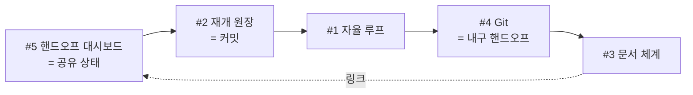

# Quetzalcoatl 프로젝트 문서

> 상태: 활성 · 날짜: 2026-10-27 · 소유자: Quetzalcoatl OS · 승인: CHENGHAO QUAN

이 디렉터리는 **Quetzalcoatl 스킬 자신의 개발**을 Quetzalcoatl의 문서 체계(SKILL.md §6)로 기록한 것이다(dogfooding). 사이클마다 결정(D)·가정(A)·리스크(R)·교차검증(QZ)·테스트·회고가 한 절씩 쌓인다. 개념 설명은 [Wiki](https://github.com/chquandogong/Quetzalcoatl/wiki), 변경 요약은 [CHANGELOG](../CHANGELOG.md).

## 현재 사이클 — v3.3.0 검증표(기능 지도) 프로토콜 (2026-10-27)

"테스트 통과"는 "동작함"이 아니다. 프로젝트성 작업은 실제 산출물을 사용자 경로로 구동해 기대와 관측을 대조하는 검증표를 두고(§11 · C-29), 증거는 검사한 범위까지만 말하며(§14), 완료는 어느 상태인지 적고(§12.1), 외부 스킬의 권한 문구는 사람의 승인을 대신하지 못한다(§1.6 · §18.2). 이번 사이클은 **행동 테스트(RED/GREEN)와 검증표 자기 적용을 릴리스 조건**으로 뒀고, 실제 GPT 교차검증을 라운드형 4회로 돌렸다(D18).

| 사이클 | 한 줄                                                                                                                                                            | 결정    |
| ------ | ---------------------------------------------------------------------------------------------------------------------------------------------------------------- | ------- |
| v3.3.0 | 검증표 · 증거 범위 · 완료 상태 · 라운드 예산/원장 · 외부 권한 불인정 · C-29 · VERIFY.md                                                                          | D18     |
| v3.2.0 | 자립 자료 — 종합 보고서·발표 대본은 정본, 덱·음성·영상은 파생 렌더 · C-27/C-28                                                                                   | D17     |
| v3.1.0 | 산출물 3층(확인층·설명층·기계층) — 정본은 사실마다 하나, 확인층은 승인 기준선 · C-26                                                                             | D16     |
| v3.0.0 | 규칙/양식/번들 소스 분리 · 모드 백킹 · 크기 라우터 · 규모 적합성 · 행동 테스트 복귀                                                                              | D13~D15 |
| v2.0.x | Core Contract 분리 · 로컬 미니멈 탈출(프레이밍 흔들기·골짜기 점검·다이얼)                                                                                        | —       |
| v1.x   | 자율 실행·회복력·문서·Git·핸드오프(v1.2.0) → 앵커된 선호(v1.3) → 미러·pre-check·드리프트 가드(v1.4) → 강제 바인딩·증거기반 완료·역량 표(v1.5) → `/context`(v1.6) | D1~D12  |

v1.4.1 이후 모든 릴리스는 **실제 Claude–GPT 교차검증**을 거쳤다.

## 문서 지도

| 단계 | 문서                                                         | 내용                                                                                            |
| ---- | ------------------------------------------------------------ | ----------------------------------------------------------------------------------------------- |
| 개요 | [PROJECT_BRIEF](00-overview/PROJECT_BRIEF.md)                | 문제·목표·성공/실패 기준 · 현재 상태(living)                                                    |
| 개요 | [DASHBOARD](00-overview/DASHBOARD.md)                        | 현재 상태 · 릴리스 히스토리 · 리스크 · 품질 지표 · 재개 지점 · 결정 대기 (SSOT, HTML 미러는 뷰) |
| 발견 | [OFFICE_HOURS](01-discovery/OFFICE_HOURS.md)                 | 의미 압박 검토                                                                                  |
| 발견 | [FEASIBILITY_REPORT](01-discovery/FEASIBILITY_REPORT.md)     | 타당성 점수화                                                                                   |
| 발견 | [ASSUMPTIONS](01-discovery/ASSUMPTIONS.md)                   | 가정과 검증 상태 (A1~A27)                                                                       |
| 발견 | [RESEARCH_NOTES](01-discovery/RESEARCH_NOTES.md)             | 조사 근거·출처 (외부 도구 진화 · Pstack/Tstack)                                                 |
| 결정 | [DECISION_LOG](02-decisions/DECISION_LOG.md)                 | 주요 결정 (D1~D18)                                                                              |
| 결정 | [ALTERNATIVES](02-decisions/ALTERNATIVES.md)                 | 대안 비교표                                                                                     |
| 결정 | [CROSS_VALIDATION_LOG](02-decisions/CROSS_VALIDATION_LOG.md) | 실제 Claude–GPT 교차검증 · 원장(QZ-1~61)                                                        |
| 명세 | [SPEC](03-spec/SPEC.md)                                      | 요구사항·수용 기준                                                                              |
| 품질 | [RISK_REGISTER](04-quality/RISK_REGISTER.md)                 | 리스크 (R1~R17)                                                                                 |
| 품질 | [TEST_PLAN](04-quality/TEST_PLAN.md)                         | 구조 검사 · 행동 테스트(RED/GREEN) · 미수행 기록                                                |
| 품질 | [VERIFY](04-quality/VERIFY.md)                               | 저장소 자신의 검증표(C-29) · 실행 기록 `verify-runs/`                                           |
| 운영 | [RUNBOOK](05-ops/RUNBOOK.md)                                 | 배포·사전승인 목록·검증·롤백                                                                    |
| 운영 | [RETRO](05-ops/RETRO.md)                                     | 사이클별 회고                                                                                   |
| 부록 | [GLOSSARY](appendix/GLOSSARY.md)                             | 보조 용어(정본은 SKILL §22 부록 A)                                                              |
| 부록 | [CONVENTIONS](appendix/CONVENTIONS.md)                       | 문서·Git 규칙(단일 기준)                                                                        |
| 부록 | [CAPABILITY_MATRIX](appendix/CAPABILITY_MATRIX.md)           | 환경별 역량·강제 수단·검증 구동 수단(본문은 도구 중립, 구체는 여기)                             |

규칙은 [appendix/CONVENTIONS.md](appendix/CONVENTIONS.md)를 단일 기준으로 따른다(혼용 금지). 저장소 밖 독자용 설명은 `wiki/`(GitHub Wiki의 소스)에 둔다.
