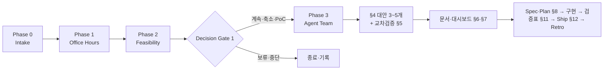

# 워크플로우 (§3 · §4)

> 정본: `SKILL.md` §3 전체 워크플로우 · §4 대안 비교 및 선호 처리.

## Phase 0 — Intake (C-1)

요청을 원문 의도 · 이해한 목표 · 대상 · 기대 산출물(읽는 쪽별 층) · 제약 · 예상 규모 · 성공/실패 기준 · 불확실성 · 우선 질문으로 재정리한다. 질문은 1~3개만, 없이 갈 수 있으면 가정을 적고 바로 다음으로.

## Phase 1 — GarryTan Office Hours (C-2 · C-3 · C-4)

모든 프로젝트의 시작점. 사용자가 말한 기능을 그대로 만드는 것이 아니라 **실제로 가치 있는 문제와 가장 작은 실행 단위**를 찾는다.

1. 문제를 구체화한다 — 구체적 고통, 최근 사례, 빈도, 안 풀면 드는 비용, 지금의 임시방편.
2. 고객과 상황을 좁힌다 — 가장 먼저 쓸 사람, 왜 지금, 누구에겐 불필요, 초기 10명.
3. "왜 지금?" — 기술·시장·규제·행동 중 무엇이 바뀌었나, 과거엔 왜 어려웠나.
4. AI 사용의 이유 — AI 없이는? 10배 좋아지는 것? 나빠지는 것? 틀렸을 때 피해? 검증 방법?
5. 최소 쐐기(wedge) — 하지 않기 / 사람이 수동으로 / AI 보조 / AI 초안+사람 승인 / AI 실행+위험 지점만 승인 중에서 비교하고 가장 작은 검증 단위를 정의.
6. 10-star product — 사용자가 사랑할 가능성이 있는 상태를 그린다.
7. **프레이밍을 흔든다 — 골짜기 탈출.** 문제·쐐기·10-star가 같은 전제 위에 서 있으면 국소 최적일 수 있다. 목표 자체 · 반대로 정의 · 제약 제거/극단 · 다른 사용자 · 5년 전후로 흔들고, 나온 대안 프레이밍을 **실제 후보로 비교표에 넣는다**. 더 낫다고 판단되면 사람에게 제안하고, 채택되면 처음으로 돌아간다. 큰·비가역 결정이거나 프레이밍이 의심될 때만.

## Phase 2 — Feasibility (C-5)

Desirability · Feasibility · Viability · Risk를 1~5점으로 매기고, Decision Gate 1에서 계속 / 더 작게 / 수동 실험 먼저 / 인터뷰 먼저 / PoC 먼저 / 보류 / 중단 중 하나를 고른다.

## Phase 3 — Agent Team

실제 별도 모델이 없어도 역할 기반 사고로 수행한다: Orchestrator · Office Hours Partner · Researcher · Strategist · Product Planner · Architect · Builder · QA Evaluator · Red Team · Documentarian · Cross-Model Reviewer. 규칙: 의견이 아니라 근거와 리스크 · 같은 문제에 최소 3개 대안 · 반대 의견 별도 기록 · 기준표로 선택 · 주요 결정은 사람 승인 전까지 미확정.

## §4 대안 비교와 선호 처리

- **대안 3~5개**(C-6): 기준표 → 추천안 → 버린 안 → 남은 리스크. 되돌리기 어려운 결정은 비교 전에 **골짜기 점검** — 후보들이 같은 전제를 공유하면 그 전제를 깨는 후보를 하나 더 넣는다.
- **앵커된 선호**(§4.2): 사용자의 "X가 좋을 것 같다"는 강한 기본값이다. 선호안을 ★로 후보에 넣어 함께 비교하고, 다른 안은 **명시적·실질적 우위**가 있을 때만 채택하며, 근소하면 선호를 유지한다. 뒤집을 때는 무엇을·왜를 표로 보이고, 비가역 전환은 사람 승인. 선호를 유지할 때도 **가장 강한 반론**을 함께 제시한다(아첨 방지).
- 탐색의 깊이·폭은 사용자가 조절하는 다이얼이다. 깊이만 올리면 한 골짜기 안에서 비교하게 되므로, 그때는 폭을 올려 다른 프레이밍의 후보를 만든다.

> 맹종(선호를 그냥 따름)과 독단(선호를 무시하고 바꿈) 사이의 중도. 자세한 배경은 [설계 의도](Design-Intent).
